# Multi-Property Booking System — Client

A React front end for managing day-by-day bookings across many properties: venues, rentals, or anything you rent out one day at a time. It covers most of what the [Flask API](https://github.com/Benjamin0-1/calendar-app-server-flask) offers.

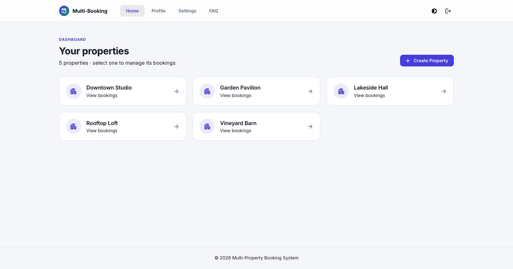

## Features

- **Properties:** create properties and see them all on one dashboard.
- **Bookings:** book a date for a customer, edit or move it, and delete it. Each booking shows whether it's upcoming or past.
- **Deleted bookings:** review removed bookings and clear them permanently.
- **Accounts:** sign up with email (with confirmation) or Google, log in, and reset a forgotten password.
- **Profile and security:** update your name, change your password, and review your login history by device.
- **Light and dark mode:** remembered per device. The layout also works on mobile.

## Screenshots

| | |
|---|---|
| 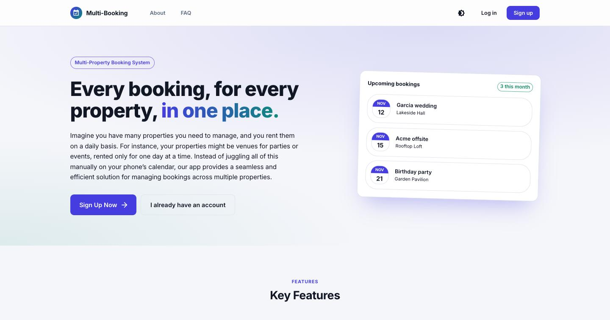 | 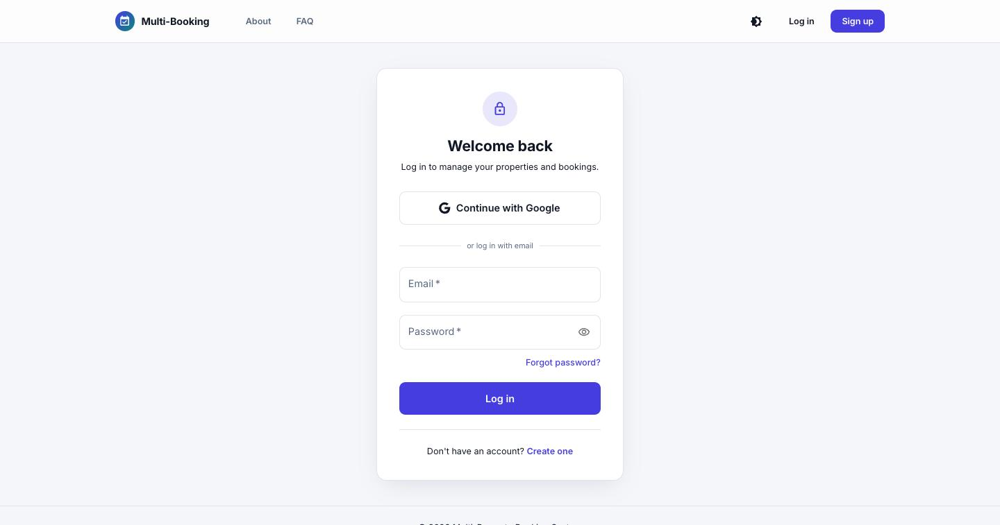 |
| 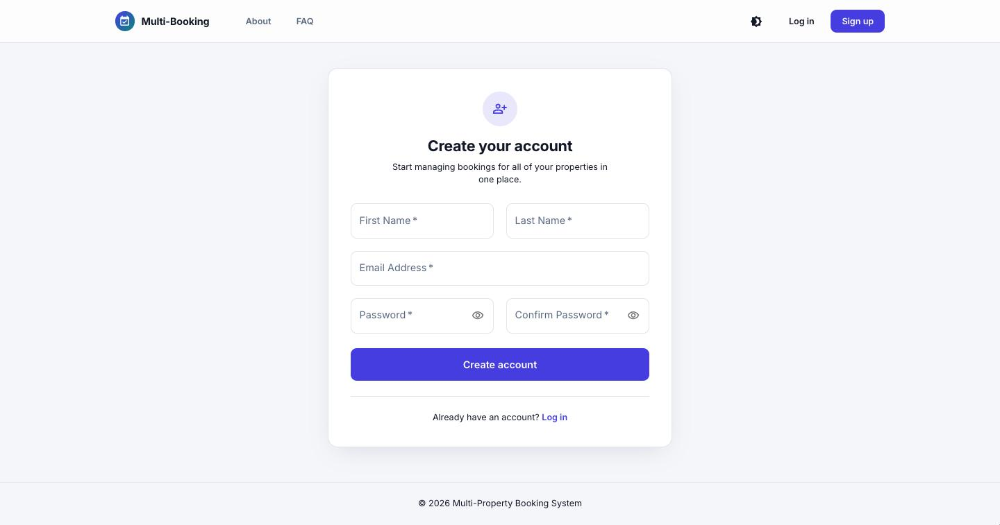 |  |
| 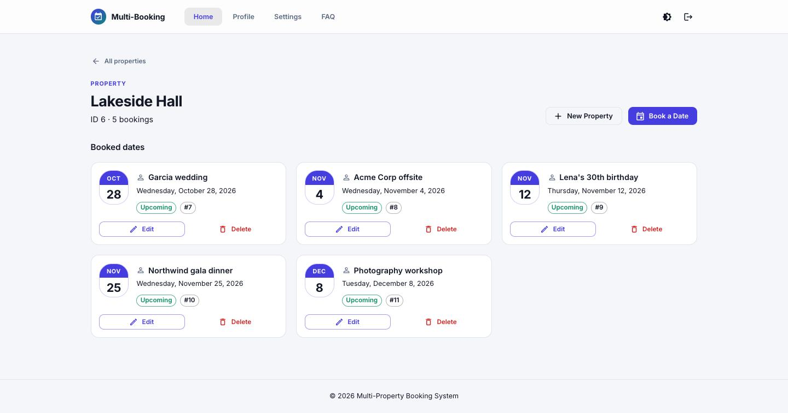 | 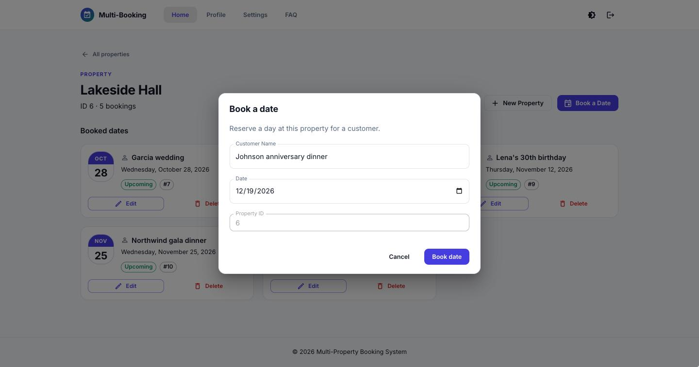 |
| 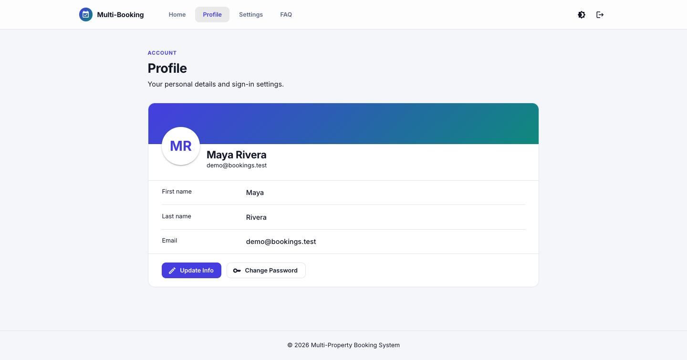 | 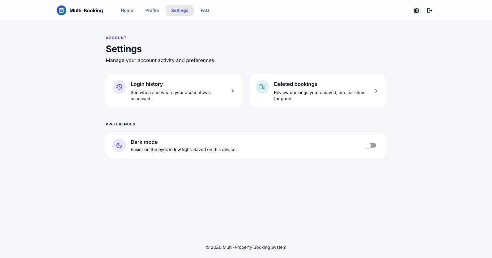 |
| 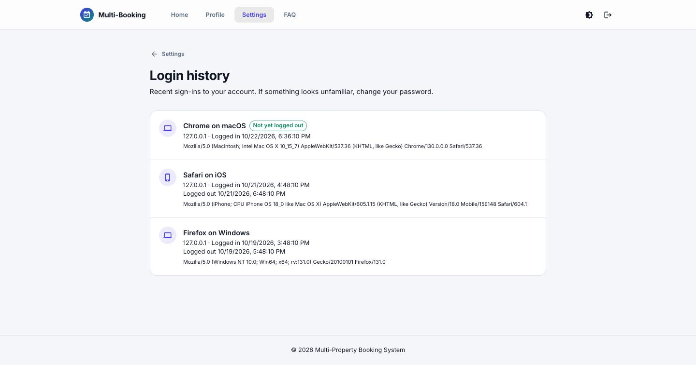 | 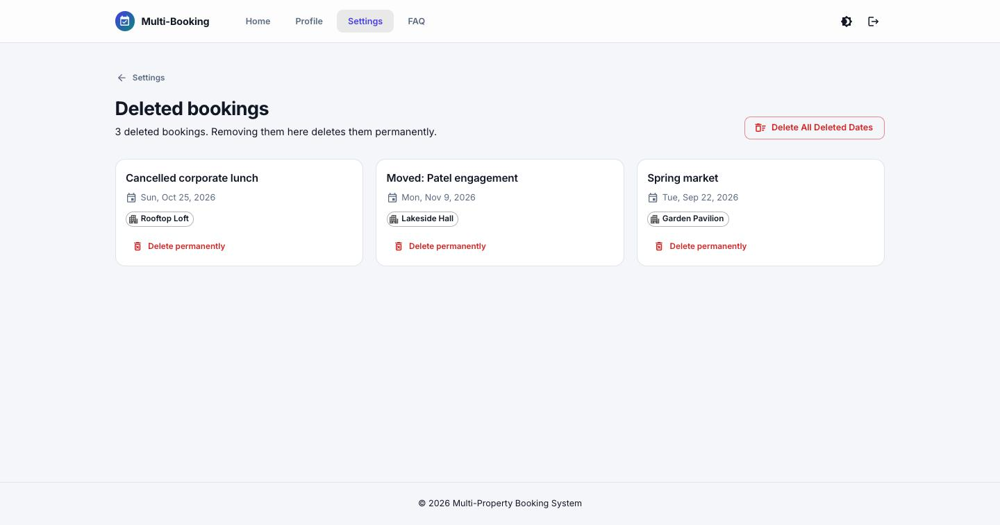 |
| 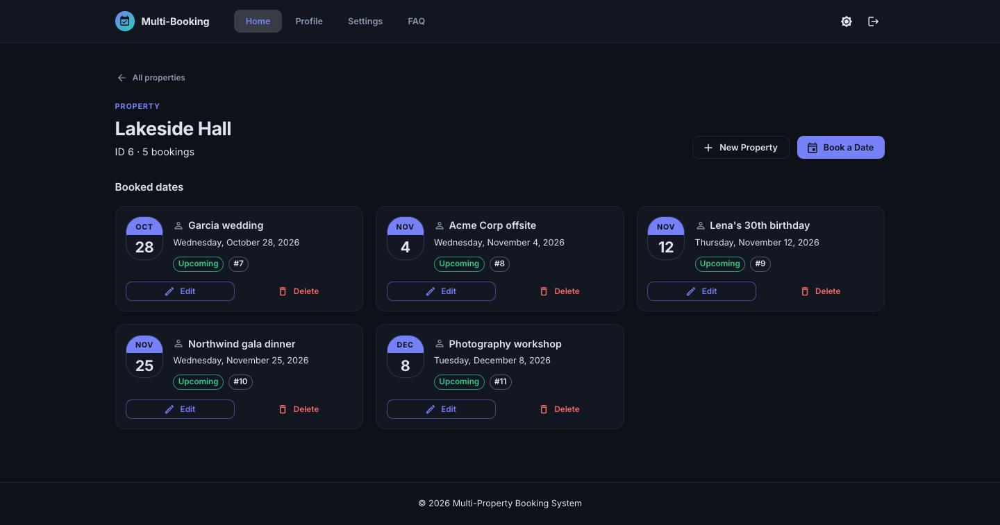 | |

## Tech stack

React 19, Material UI 9, React Router 8, Vite 8, Firebase Auth (Google sign-in), react-toastify and date-fns.

## Getting started

**Requirements:** Node.js 22.22 or newer, and the [API](https://github.com/Benjamin0-1/calendar-app-server-flask) running locally.

```bash
npm install
npm run dev
```

The app runs at http://localhost:5173. Keep that port: the API's CORS settings only accept requests from it.

### Configuration

Set the API's address in `.env`:

```bash
VITE_API_URL=http://127.0.0.1:5000
```

On macOS, AirPlay Receiver uses port 5000. Either turn it off (System Settings → General → AirDrop & Handoff) or run the API on another port and override the URL when starting the client:

```bash
VITE_API_URL=http://127.0.0.1:5001 npm run dev
```

## Scripts

| Command | What it does |
|---|---|
| `npm run dev` | Start the dev server |
| `npm run build` | Build for production into `dist/` |
| `npm run preview` | Serve the production build locally |
| `npm run lint` | Run ESLint |
